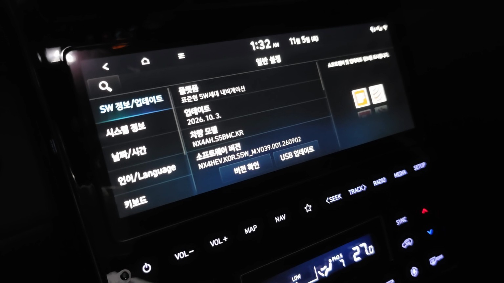
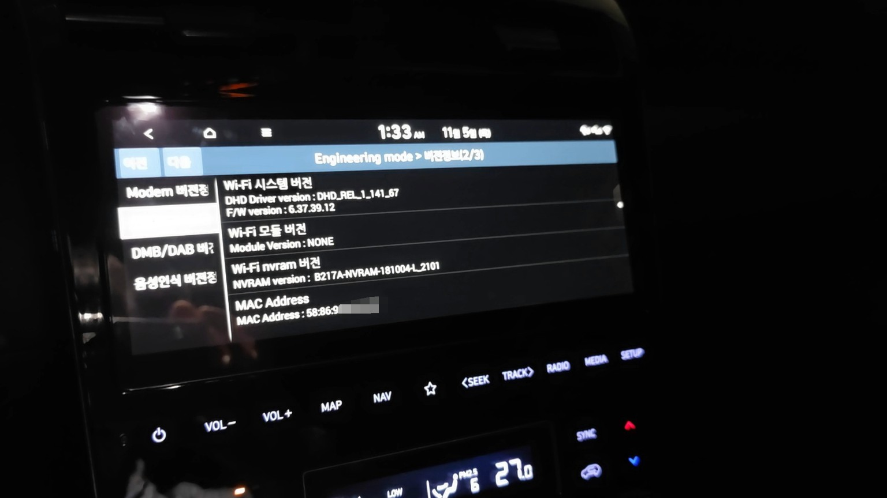
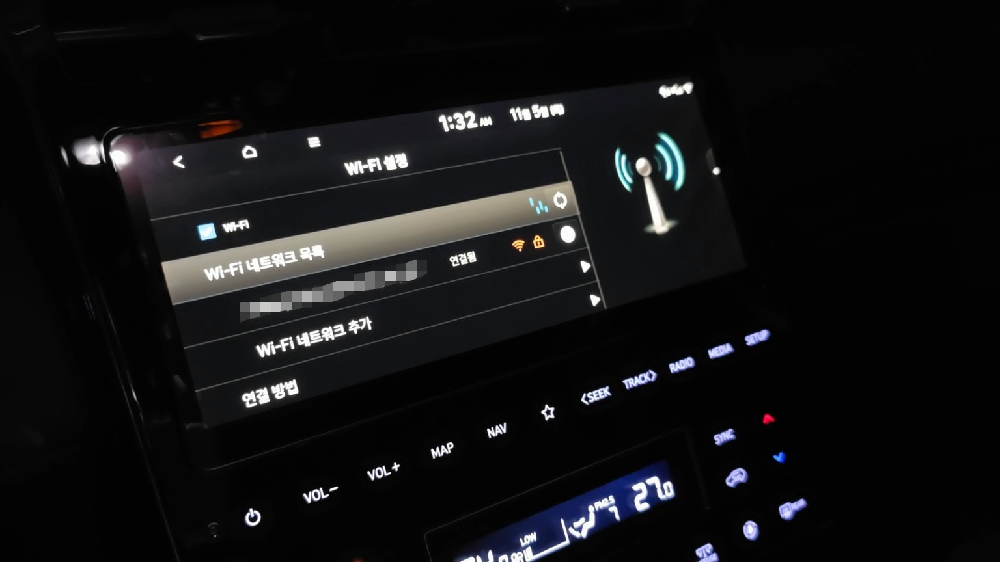

# NX4 Gen5W RTL8188EU

현대 투싼 NX4 HEV의 AVNT STD G50 WIDE R6 헤드유닛에서 ipTIME N150L (RTL8188EU, VID:PID `0bda:8179`)을 시험한 실험용 드라이버 프로젝트입니다. 현대자동차·현대모비스·Realtek의 공식 프로젝트가 아닙니다.

## 실차 검증 상태

사용자가 제공한 실차 시험 결과에서 아래 전체 경로가 성공했습니다: 모듈 로드 → USB 인식 → `wlan0` 생성/활성화 → AP 연결 → DHCP → 외부 IP 통신 및 DNS 조회 → 무선 ADB. 검증 환경과 단계별 근거는 [VALIDATION.md](VALIDATION.md)에 기록했습니다.

이 결과는 Linux `3.18.24-tcc`, ARMv7, Android 4.4.2, NEMESIS v1.16.7 및 특정 AVNT R6/N150L 구성에서 보고된 실차 성공입니다. 다른 헤드유닛, 차량, 커널, 동글에 대한 호환성을 보장하지 않습니다.

### 실차 화면 기록

아래 사진은 시험 대상 헤드유닛의 소프트웨어 정보, Engineering mode의 Wi-Fi 시스템 정보, 그리고 차량 화면에서 AP가 연결된 상태를 보여줍니다. Engineering mode 사진은 내장 Wi-Fi 정보에 대한 참고이며, USB RTL8188EU 자체의 연결 성공을 증명하지는 않습니다. 사진만으로 IP 통신이나 Wireless ADB까지 확인되는 것은 아니며, 그 결과는 [단계별 검증 기록](VALIDATION.md)을 참조하세요. SSID는 가렸고 MAC 주소는 일부만 표시했습니다.

| 헤드유닛 소프트웨어 정보 | Engineering mode Wi-Fi 정보 | Wi-Fi AP 연결 화면 |
|---|---|---|
|  |  |  |

## 진단 방향

- 해당 환경에서 커널 모듈과 Wi-Fi/IP 통신은 성공했습니다. 이전의 `insmod` 성공만 있거나 `wlan0`가 없던 캡처는 별도의 이전 상태이며, 이후 성공 결과를 덮어쓰지 않습니다.
- Android Auto 프로젝션 패키지 `com.google.android.projection.sink`를 비활성화한 후 Wi-Fi 성공이 관찰됐습니다. USB accessory 요청과 `EPROTO -71`도 앞선 시도에서 관찰됐지만 내부 원인은 규명되지 않았습니다. [통합 이슈 #1](https://github.com/EGG-RAMYON/nx4-rtl8188eu-kmod/issues/1)에서 드라이버 문제와 분리해 추적합니다.
- Wi-Fi가 통신된 뒤에도 NEMESIS v1.0.3 서비스가 인터페이스 up 시도를 반복한 로그가 있었습니다. 상태 문자열 검사와 로그 디렉터리 초기화 문제로 분리해 [서비스 이슈 #2](https://github.com/EGG-RAMYON/nx4-rtl8188eu-kmod/issues/2)에서 추적합니다. 이 로그는 커널 드라이버 실패를 뜻하지 않습니다.
- v1.0.3 STOP에서 Android Auto 복원이 확인됐지만, 모든 START/STOP·실패·재부팅·재연결 경로는 검증되지 않았습니다.

## 바이너리와 소스 추적성

현재 GitHub에 Release가 없어 Release 바이너리는 없습니다. NEMESIS v1.0.3 패키지에서 보유한 모듈은 NX4D1 진단 마커와 대상 vermagic을 포함하지만, 실차에서 성공한 모듈의 SHA-256 및 빌드 기록과 byte-identical인지 확인되지 않았습니다. 따라서 이 패키지 모듈을 실차 성공 바이너리 또는 현재 공개 소스의 재현 빌드라고 단정하지 않습니다. 세부 해시와 확인 필요 사항은 [VALIDATION.md](VALIDATION.md)를 참조하세요.

현재 공개 소스에 대한 NX4 R6 커널 교차 빌드는 [BUILD_NX4.md](BUILD_NX4.md)에 설명되어 있습니다. 성공 바이너리의 식별과 빌드 출처가 확인되기 전까지 검증된 실차 바이너리로 Release에 표시하지 않습니다.

## 저장소 구성 및 시험

- `driver-src/`: Realtek v5.3.9_28540.20180627 기반의 포팅·NX4D1 계측 소스
- `patches/`: cfg80211 포팅, 초기화 계측, 셸 수정 패치
- `scripts/`: NX4 커널 준비, ARM 빌드, ABI/심볼 검사
- `vehicle/`, `USB_READY/`: NEMESIS 진단 소스
- `SOURCES.md`, `LICENSE`, `LICENSE_SCOPE.md`: 출처와 라이선스

호스트 모의 시험:

```sh
python3 tests/test_vehicle_scripts.py
```

차량별 커널 설정, 제조사 커널 소스, 원시 진단 로그, SSID, MAC, IP 주소 및 VIN은 저장소에 포함하지 않습니다.